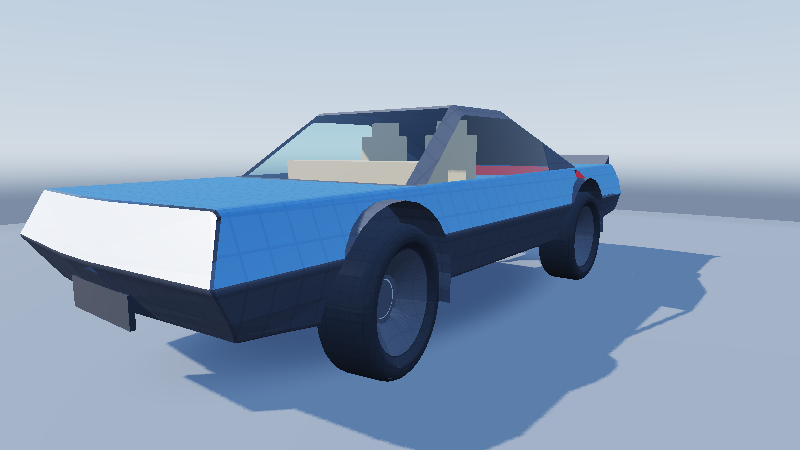
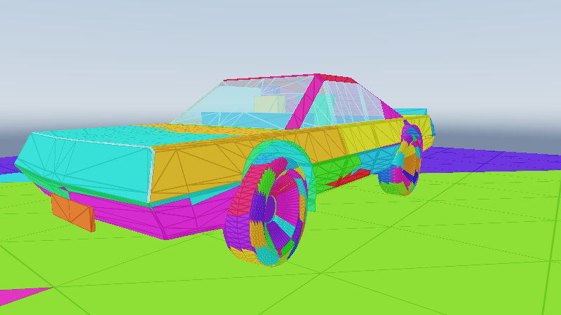
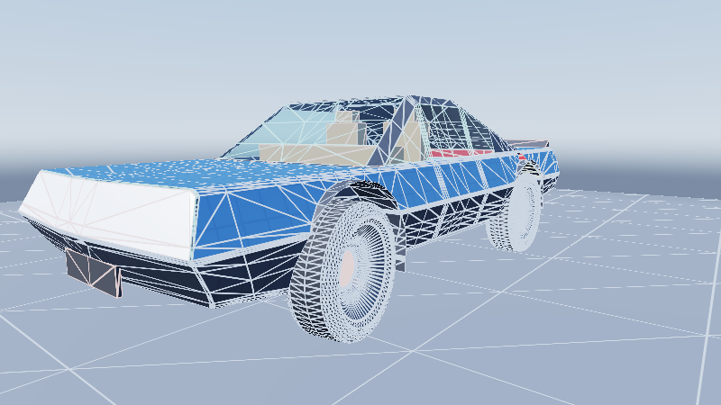
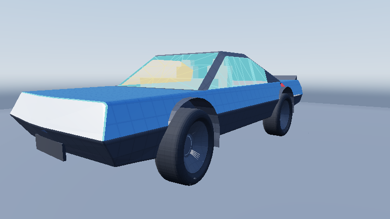

# Cluster Refinement, Material Virtualization, `ControlVehicle`, & Modular `#if FRONTIER_EDITOR` `PreviewRaster` Exhibits

End-to-end CPU + Vulkan 1.3 Slang compute verification for Frontier's glass-aware QEM `ScreenSpaceClusterRefinement`,
3-tier virtualized materials (`FullStrata` / `FilteredToksvig` / `CompactProxy`), `64 KB` page residency & RAM/VRAM
telemetry, `PrimitiveGeometryGenerator` + binary `FCT1` `ControlVehicle{Body,Rim,Tyre}.facet` assembly,
`ThemeStructure`-bound card tokens, and Editor/Development-only (`#if FRONTIER_EDITOR`, zero symbols in Shipping)
`PreviewRaster` with simple Blinn-style lighting and basic `PreviewShadowMode` options (`None`, `ContactEllipsoid`,
`OrthoClusterDepth`).

## Vulkan 1.3 Preview & Inspection Captures (`800x450`)

| Capture | Verified Systems Shown |
|---|---|
|  | **`PreviewShadowMode::OrthoClusterDepth` (`ControlVehicleShadedPreview.png`)**: Simple Blinn-style preview lighting, `1024x1024` atomic orthographic active-cluster solar shadow depth + 5-tap PCF directional shadow, 2-layer glass transparency, and visible cabin interior. |
|  | **Cluster Identity (`ControlVehicleClusterIdentity.png`)**: Per-cluster golden-ratio ID palette across body, rims, tyres, and plinth, plus translucent cyan glazing showing interior clusters surviving two-phase opaque-only Hi-Z culling. |
|  | **Shaded + Cluster Wireframe (`ControlVehicleRefinementAndWireframe.png`)**: Anti-aliased `1 px` screen-space barycentric triangle edges colored by QEM refinement tier over shaded automotive surfaces. |
|  | **Two-Layer Glass Peel (`ControlVehicleGlassLayerPeel.png`)**: Single-layer cyan vs two-layer amber-gold dielectric glazing thickness peel over surviving interior cabin geometry. |
