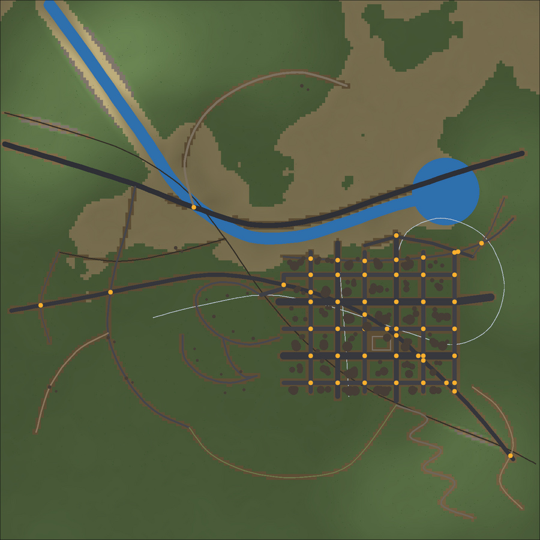

# Frontier

**A robust 2D/3D road-network & city editor for games** — draw roads, rails, monorails, rivers and terrain in a top-down 2D editor and watch them build themselves in a live 3D view. Ships with a complete demo project: *Frontier City*, a full road network running from countryside → city → offroad.



## Features

### Editing
- **2D top-down editor** (canvas) with pan/zoom, grid snapping, endpoint snapping, and nine tools: Select/Move, Draw Road, Draw Rail/Monorail, Draw River, Place Lake, Place Building, Plant Trees, Terrain Brush, Erase.
- **Live 3D view** (Three.js) that reflects every edit — split view shows both side by side. Click objects to select them, drag road vertices on the ground plane.
- Full **undo/redo** (Ctrl+Z / Ctrl+Y), JSON save/load, one-click reload of the demo city.
- Vertex editing: double-click a stroke to insert a vertex, Alt-click a vertex to delete it.

### Roads & topology
- **Preset library** of 18 road types: highways (2+2, 3+3), expressways, avenues, boulevards with median strips, bus-lane avenues, city streets with parking lanes, cycle streets, residential lanes, pedestrian zones (cobbled), service roads, country roads, gravel roads, farm tracks, dirt tracks, offroad trails and mountain passes.
- Presets define **lane layouts** (drive / parking / bike / bus / median / verge), widths, pavement (sidewalk) width & kerb height, marking style, surface type and colours.
- **Clean quad-flow topology**: road surfaces are quad strips per lane band; intersections merge any mix of road types into quad-ring junction patches with a centre fan, so junctions stay flush with every arm regardless of width.
- Automatic **topology resolution** at build time: stroke endpoints snap together, strokes crossing at grade are split and merged into T/X junctions; grade-separated crossings simply pass over.
- **Road markings**: dashed/solid lane dividers, single/double/double-yellow centre lines, edge lines, zebra **crosswalks**, stop lines — all trimmed to stop at junction mouths.
- **Pavements** with kerb faces, and **kerb ramps** (dropped curbs with tactile pads) at every junction entrance.

### Bridges, terrain & water
- **Terrain heightfield** (procedural fbm + editable brush stack: raise / lower / flatten / smooth) that both *shapes* the roads and is *shaped by* them — roads carve cut/fill corridors, smooth their grades and limit gradients.
- **Auto-bridging**: roads and rail that pass over lakes/rivers (or are flagged as bridges) rise onto decks with edge girders, railings and piers down to the ground. Bridge spans leave the terrain/water underneath untouched.
- **Water**: wobbly-shape lakes and polyline rivers; terrain is carved into lake basins and riverbeds with sandy shores.

### Rail
- **Heavy rail** (ballast prism, sleepers, rails) with **level crossings** (aprons + crossbucks) where roads cross at grade.
- **Elevated monorail** on pylons, flying over roads, rivers and the lake, with stations every ~400 m. Monorail decks automatically clear the roads they cross.
- Tram-track preset for light rail at street grade.

### City
- Blocky **buildings** (flat/gable/stepped roofs, towers, houses, barns) with rooftop detail.
- **Low-poly trees** — pine, oak, palm, dead — scattered with terrain/slope/water/road-aware placement.

## Getting started

```bash
npm install
npm run dev        # open http://localhost:5173
```

Other scripts:

```bash
npm run build      # typecheck + production build to dist/
npm run preview    # serve the production build
npm run smoke      # headless geometry-pipeline smoke tests (node)
```

## Using the editor

| Action | How |
| --- | --- |
| Draw a road/rail/river | Pick the tool, click to place points, **Enter** or double-click to finish, Esc cancels |
| Choose road type | Click a preset in the *Road Type Library* (sets the active type, or re-types the selected road) |
| Junctions | End or cross strokes on each other — they merge automatically |
| Force a bridge | Select a road/rail and tick *Force bridge / viaduct* (or *Elevated* for rail) |
| Sculpt terrain | Terrain Brush tool: raise / lower / flatten / smooth with radius & strength sliders |
| Keys | `1–9` tools, `F` frame all, `G` grid, `Ctrl+Z`/`Ctrl+Y` undo/redo, `Del` delete |

## Architecture

```
src/
  core/       data model, math/polyline helpers, preset library, project store (undo/redo)
  gen/        pure geometry pipeline (no DOM):
              terrain.ts  heightfield + brushes + road/river/lake carving
              roads.ts    deck planning, junction topology, quad strips, markings,
                          pavements, kerb ramps, bridge furniture
              rails.ts    heavy rail, monorail, level crossings
              water.ts    lakes & rivers
              city.ts     buildings, trees, scatter helpers
              build.ts    world-build pipeline used by the 3D view
  three/      Three.js scene (meshes, lights, picking, orbit)
  editor/     2D canvas editor + tools, UI shell (toolbar, presets, properties)
  demo/       the "Frontier City" demo project + smoke tests
```

Everything is stroke-based: roads/rails/rivers are polylines with a type. Topology (junction merging, crossing splits) is resolved at build time, which keeps editing simple and robust while output meshes stay clean and quad-flow.

## License

MIT
