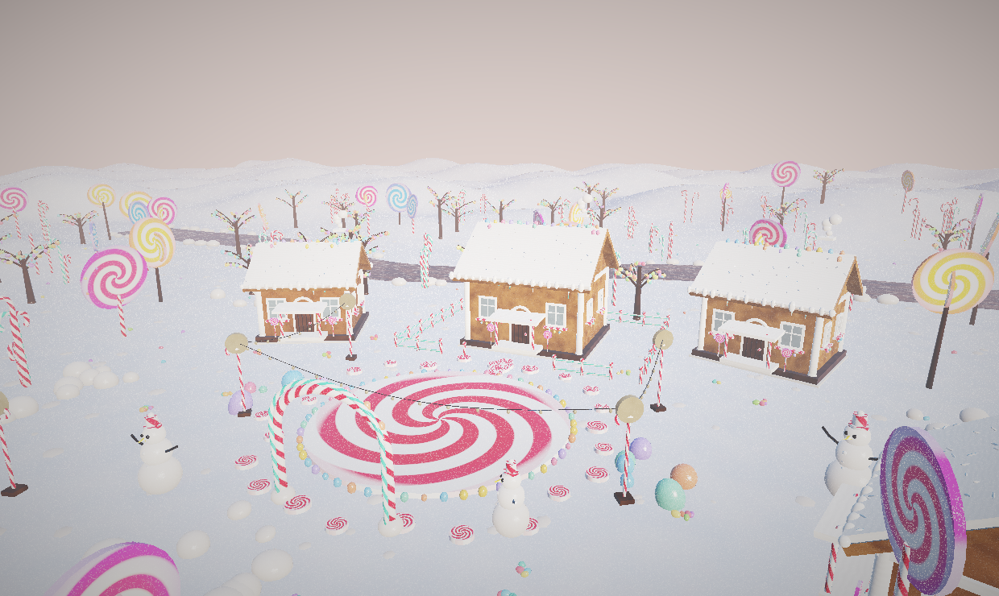
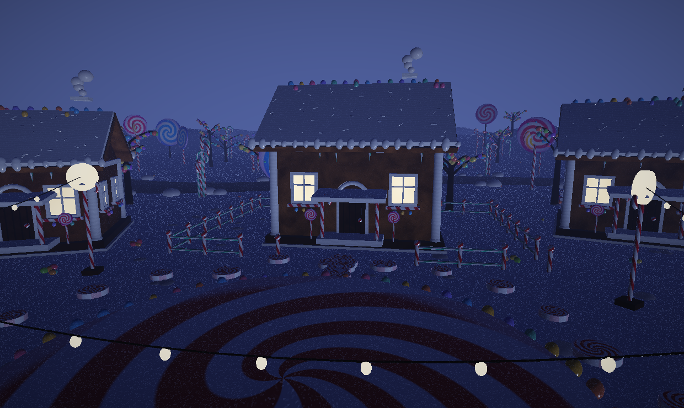

# 🍬 Sugarplum Hollow

A **fully procedural gingerbread-and-candy village** rendered in real time with **WebGPU**.
No textures. No models. No image files anywhere in the pipeline — every vertex, every
material and every pixel is generated by code from a single seed.



---

## What's in the village

| | |
|---|---|
| 🏠 **Gingerbread cottages** | Piped royal-icing corners & eave scallops, icing "snow" roofs, gumdrop ridge tiles, sugar-glass windows that glow at night, chocolate doors under arched icing, candy-cane porch columns, icicle candy, chimneys puffing marshmallow smoke |
| 🍭 **Candy forest** | ~200 lollipop trees (swirled hard-candy discs on candy-cane trunks), jellybean orchard trees, and candy-cane groves |
| 🫘 **Jellybean fruit** | ~2 000 instanced jellybeans: hanging in clusters from branch tubes on icing threads, clinging to lollipop rims, dropped on the snow |
| ☁️ **Marshmallows** | Drifts, river banks, snowman bodies, chimney smoke, and powdered-sugar snow lumps |
| 🍫 **Chocolate river** | A flowing ribbon of tempered chocolate with animated swirl noise, plus a gingerbread bridge with icing rails |
| 🍬 **Peppermint plaza** | A giant swirled peppermint puck with a gumdrop border and peppermint stepping stones |
| 🕯️ **Extras** | Candy-cane fences & gateway arches, lollipop lampposts, festoon string lights, gumdrop boulders, snowmen, 7 000 wind-blown snowflakes, a full day/night cycle |



---

## Run it

```bash
npm start          # http://localhost:5173
```

Then open the URL in a **WebGPU-capable browser** (Chrome/Edge 113+, Safari 18+ on macOS).
It must be served over HTTP (ES modules + `fetch` of the `.wgsl` sources), not opened
from `file://`. No dependencies, no build step.

### Controls

| Input | Action |
|---|---|
| drag | orbit |
| scroll / pinch | zoom |
| right-drag / shift-drag | pan |
| `1` `2` `3` `4` | jump to Village / Plaza / Forest / River view |
| `Space` | toggle auto-orbit |
| `R` | reset view |
| `H` | hide the UI |
| sliders | time of day, snowfall, resolution scale, glow |

---

## How it works

### Everything is procedural geometry

`src/geo.js` contains a handful of primitives — box, cylinder/cone, UV sphere, swept
tube with parallel-transport frames, disc/coin, triangular prism, ribbon and terrain
grid. `src/world.js` composes them into houses, trees, fences, arches and rivers,
baking every transform into one large vertex/index buffer. Draw calls are then
**compacted by material**, so the whole village renders in ~26 draws.

Small repeated objects (jellybeans, gumdrops, sprinkles, marshmallows, snow lumps,
lamp beads) are drawn as **instanced unit primitives** from a single shared storage
buffer, packed as `position / scale / quaternion / tint` (64 bytes each). The vertex
shader rebuilds the matrix from the quaternion and corrects normals for non-uniform
scale (`n' ∝ R·(n/s)`), which is what lets the same sphere become a bean, a sprinkle
or a squashed marshmallow.

### Everything is a procedural material

All of it lives in `src/scene.wgsl`. Nothing is sampled from a texture; material
appearance is evaluated from **world-space 3D noise** (value noise fBm + 8-tap Worley),
so patterns flow continuously across every object in the village.

| Material | How it's made |
|---|---|
| **Gingerbread** | Domain-warped fBm for the crumb, Worley cells for baked pores, high-frequency cell hash for speckle, upward-facing icing-sugar dusting, oven-darkening on surfaces facing away from the sky |
| **Royal icing** | Piped ridge ridges from `sin(uv · 30 + noise)`, creamy fBm veins, very low roughness + heavy clearcoat for the wet-sugar sheen |
| **Tempered chocolate** | Two-layer warped fBm swirl, cocoa speckle, roughness driven by the swirl so highlights slide across it |
| **Candy cane** | Helical stripes from `fract(uv.y·k + uv.x·2)` (uv.y is *distance along the tube*, so the twist is consistent at any scale), sugar-crystal roughness jitter |
| **Lollipop / peppermint** | Polar swirl `sin(atan2(y,x)·arms ± r·freq)` evaluated on planar UVs baked into the geometry, white/red or white/pink arms |
| **Jellybean** | Per-instance tint, fine Worley sugar speckle, strong fake subsurface + high clearcoat so it looks like translucent jelly |
| **Gumdrop** | Per-instance pastel tint, sugar-coating crystals from two Worley octaves |
| **Marshmallow** | Soft fBm pores, powdered-sugar dusting, very high scatter |
| **Sugar snow** | Layered fBm with pink/mint sugar tints, Worley crystal grain, twinkling sparkle |
| **Sugar glass** | Cold blue glass by day; warm candle-lit emission with a slow flicker at night |
| **Chocolate river** | Animated swirl noise advected along the flow direction, milky-cream streaks, high gloss |

Micro-detail comes from `perturbNormal()`: the gradient of a noise field is projected
onto the surface tangent plane, so pores, crumbs and ripples get real shading without
any tangent attributes.

### Lighting

Directional sun + hemispheric sky ambient, GGX-ish specular with a clearcoat layer,
Fresnel rim, fake translucency (`pow(dot(V,−L))`), physical-ish environment reflection
of the procedural sky, and **view-dependent sugar sparkle**: a high-frequency Worley
field twinkles in time and only where the half-vector lines up, which is what makes
the snow and candy glitter.

Shadows use a single 2048² depth map with 3×3 PCF (`textureSampleCompareLevel`, so it
is legal in non-uniform control flow). Aerial perspective fades everything into the
procedural sky colour.

### Render passes

1. **Shadow** — depth-only, 2048², normal-offset + slope-scaled depth bias
2. **Scene** → `rgba16float` HDR — fullscreen procedural sky (gradient, sun disc,
   cotton-candy cloud bank, stars & aurora at night) → opaque geometry → additive snow
3. **Bloom** — threshold + 2× separable Gaussian at half resolution
4. **Composite** — ACES tonemap, candy colour grade, vignette, grain, gamma

---

## Repository map

```
index.html            page shell + UI
styles.css            glassmorphic UI styling
server.mjs            dependency-free static server
src/main.js           camera, day/night cycle, UI wiring, frame loop
src/sky.js            sun/sky colour model (shared with the dev tools)
src/math.js           column-major mat4, quaternions
src/geo.js            procedural primitives + mesh builder
src/world.js          the village: layout, houses, forest, river, instancing
src/materials.js      material ids + candy palette (sRGB → linear)
src/renderer.js       WebGPU device, pipelines, bind groups, passes
src/scene.wgsl        scene shader: every material, lighting, sky, snow
src/post.wgsl         bloom + tonemap
tools/validate.mjs    compiles both shaders with naga (wgpu's compiler)
tools/gpu-lint.mjs    offline WebGPU validation harness — runs the real renderer
                      headlessly against a spec-faithful mock device and checks
                      bind groups, pipeline layouts, vertex fetch and draw ranges
tools/check-world.mjs headless geometry checks (winding, NaNs, quaternion maths)
tools/preview-render.mjs  CPU rasterizer — renders the village without a GPU
tools/matlib.mjs      JS transcription of the WGSL materials, used by the preview
```

## Development tools

```bash
npm i naga-wasm@30.2.0 --no-save
npm run validate      # WGSL → naga parse + validate + re-emit
npm run check         # world sanity checks
npm run lint          # offline WebGPU validation (pipelines, bind groups, draws)
node tools/preview-render.mjs village|plaza|forest|river|top|house
HOUR=21.4 node tools/preview-render.mjs plaza   # night
```

`tools/preview-render.mjs` is a small software rasterizer that consumes the *same*
baked buffers and shades fragments with a JavaScript transcription of the WGSL
material library. It exists so the scene can be inspected on machines without a GPU
(it is how the screenshots above were produced — so they show the procedural
materials, sky and lighting, but not the shadow map, bloom or falling snow that the
WebGPU renderer adds).

## Notes

- The world is deterministic from a seed: `buildWorld(20251224)` in `src/world.js`.
- ~185 k static triangles + ~7 400 instances, ~26 draw calls, one shadow map.
- Instancing uses instanced vertex attributes rather than vertex-stage storage
  buffers, so it also runs on implementations where
  `maxStorageBuffersInVertexStage` is 0 (WebGPU compatibility mode).
- Everything is regenerated at load time in ~200 ms — there are no assets on disk.
