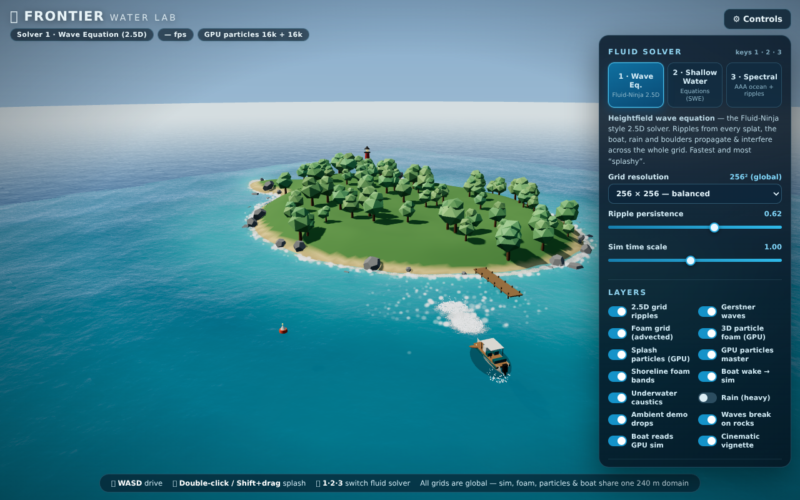

# 🌊 Frontier — Water Lab



A realtime **2.5D + 3D water simulation sandbox** in the browser (WebGL2 / Three.js),
built like a game-engine water stack (think *Fluid Ninja* heightfields meets an AAA ocean):

- **3 switchable grid fluid solvers** — all *global*: one 240 m × 240 m domain, so the
  heightfield, foam, particles, boat and shoreline all share the same grid and stay in sync.
- **Advected foam grid** (crest foam + boat wake + shoreline bands), transported by the
  solver's own velocity field.
- **100 % GPU particles** (texture ping-pong, zero per-particle CPU work):
  ballistic **splash droplets** + floating **3D foam flecks** that ride the simulated
  surface and only appear where the foam grid says there is foam.
- **AAA water shader**: analytic sky reflection (same sky function as the dome),
  Beer–Lambert depth absorption, subsurface scattering, dual-lobe sun glints,
  shoreline soft edge + lacy foam breakup, distance fog, ACES tone mapping.
- A **drivable boat** with 4-probe buoyancy sampled from the *actual GPU simulation*
  (throttled readback) + analytic waves — it pushes wake splats, foam trails and bow
  spray back into the grid.
- An island with beach, sandbar, second islet, dock, buoys, rocks that waves break on,
  and a lighthouse (working rotating beams at night) so you can judge the shoreline.

## The three solvers (keys `1` `2` `3`)

| # | Solver | How it works | Best at |
|---|--------|--------------|---------|
| 1 | **Wave-Equation Heightfield** | Classic Fluid-Ninja/GPU-Gems 2.5D ripple grid (`h`, `v`) with splat impulses, land damping and absorbing borders. 3 substeps/frame. | Interaction: clicks, rain, boat wake, boulders — fast & splashy |
| 2 | **Shallow Water Equations** | Solves water **depth + momentum** with continuity over the terrain height grid; wet/dry shoreline, wind stress, viscosity, radial impulse splats. | Physical shoreline: sloshing, beach run-up, reflections, tsunami surge |
| 3 | **Spectral Ocean** | A 24-wave Phillips-like directional spectrum (96 m → 4.6 m, crest-sharpened) **baked into the grid every frame**, layered with the solver-1 heightfield for interaction — the classic AAA "FFT + heightfield" stack. | Open-ocean swell, whitecap/crest foam, storms |

Every solver writes the same **unified output texture**
(`R` surface height · `G/B` surface velocity · `A` foam source). The water mesh,
foam grid, GPU particles and boat readback only ever consume that texture, so
switching solvers is seamless.

On top of the chosen solver you can layer analytic **Gerstner waves** (6 components,
mirrored exactly on the CPU for buoyancy) with horizontal chop displacement.

## Foam — two systems, one grid

1. **Foam grid** (ping-pong texture, semi-Lagrangian advection by solver velocity + wind,
   diffusion, two decay rates):
   - *R channel* — breaking-crest / solver foam (fast decay)
   - *G channel* — wake & shoreline foam (slow decay), fed by splats and animated
     shoreline bands over shallow depth
2. **3D foam particles** — up to 16 384 GPU flecks spawn in the boat wake, on the
   shoreline ring and at crests; they are advected by the same velocity grid, ride the
   exact surface (sim height + Gerstner), and their **visibility is gated by the foam
   grid** — turn the foam grid off and the flecks disappear.

Splash droplets are a separate GPU system (gravity, drag, surface kill) with emitters
at the boat stern (prop wash / rooster tail), bow (spray when the bow buries), plus
burst slots for clicks, boulders, rain and rocks.

## Controls

| Input | Action |
|---|---|
| `W A S D` / arrows | Drive the boat (`Space` brake) |
| Drag / wheel / right-drag | Orbit / zoom / pan |
| Double-click water | Big splash |
| `Shift`+drag or 💧 Splash-brush toggle (`B`) | Paint splashes into the sim |
| `1` `2` `3` | Switch fluid solver |
| `F` foam · `P` particles · `R` rain · `C` follow-cam | Toggles |
| `X` big splash · `G` drop boulder · `T` tsunami | Actions |

The control panel has toggles for every layer (2.5D ripples, Gerstner waves, foam grid,
3D foam, splash, shoreline bands, wake, caustics, rain, GPU-sim boat readback…),
sliders for waves/wind/foam/clarity, grid resolution (128²/256²/512²), particle count
(4 k/8 k/16 k ×2), environment presets (Midday/Golden/Dusk/Storm/Moonlit),
Calm/Storm weather presets and debug views (height / foam / velocity / normals).

Things to try: drive the buoy slalom, surf the western sandbar in Spectral mode,
drop a boulder in SWE mode and watch it reflect off the beach, hit **Tsunami** and
see it run up the shore, or go Moonlit and follow the lighthouse beam.

## Run it

```bash
npm install
npm run dev      # http://localhost:5173
npm run build    # production bundle in dist/
```

Requires WebGL2 with half-float render targets (any modern desktop/mobile browser).
Runs ≈45 fps even under *software* WebGL (SwiftShader) at 1280×800; expect a
comfortable 60+ on a real GPU. If you need more perf: grid 128², particles 4 k,
or turn off "Boat reads GPU sim" (the periodic readback).

## Code map

```
src/config.js     world constants, noise/terrain height function, terrain+noise
                  textures, shared Gerstner set (GLSL uniforms + JS mirror)
src/shaders.js    all GLSL: 3 solvers, output unify, foam advection, sky,
                  water surface, far ocean
src/sim.js        WaterSim — render-target ping-pong, splat queue, solver
                  stepping, foam pass, CPU height readback cache
src/particles.js  GPUParticles — splash + 3D foam systems (update & render)
src/boat.js       lofted-hull boat, buoyancy, propulsion, wake interaction
src/world.js      island/terrain (+caustics), sky, water mesh, props, env presets
src/main.js       loop, UI wiring, input, weather/actions, camera
```

*Everything is procedural — no external assets.* Debug hooks are exposed as
`window.__frontier` in devtools (scene, sim, boat, params, actions…).
